<a href="https://danbrand.nyc"></a>

  <a href="https://danbrand.nyc"><b>danbrand.nyc</b></a> ·
  <a href="https://linkedin.com/in/dan--brand">LinkedIn</a> ·
  <a href="mailto:dan@danbrand.nyc">dan@danbrand.nyc</a> ·
  New York, NY

I'm Daniel, an AI systems engineer and full-stack builder with 7+ years of shipping production software. I work like a coordinator with a small company of AI agents: I scope the goal, split it into workstreams, hand each one to the right specialist, and review every diff before it ships. So the honest pitch is simple: **what do you need done?**

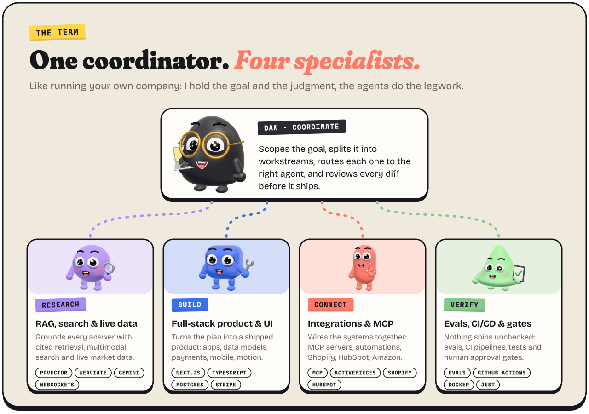

 

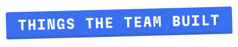

<a href="https://danschewy.github.io/dellxnvidia-chat-platform/">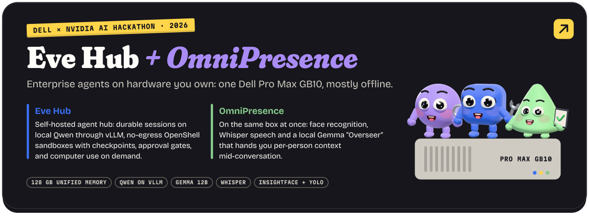</a>

  <b>Eve Hub</b> <a href="https://danschewy.github.io/dellxnvidia-chat-platform/">pitch deck</a> · <a href="https://github.com/danschewy/dellxnvidia-chat-platform">code</a>
  &nbsp;&nbsp;|&nbsp;&nbsp;
  <b>OmniPresence</b> <a href="https://github.com/danschewy/dellxnvidia-devin">code</a>

<a href="https://danschewy.github.io/dellxnvidia-chat-splat/">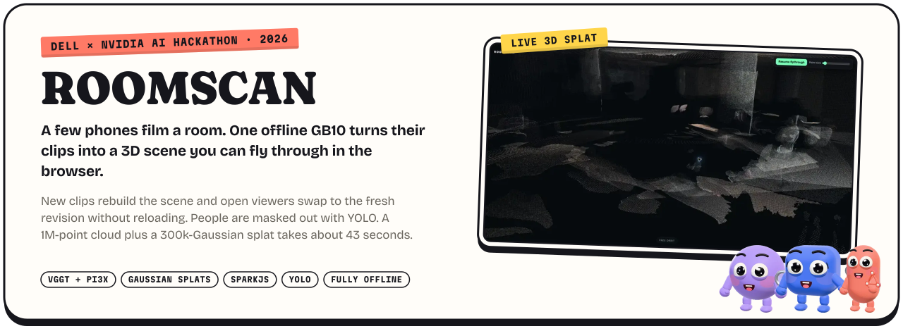</a>

  <b>ROOMSCAN</b> <a href="https://danschewy.github.io/dellxnvidia-chat-splat/">pitch deck</a> · <a href="https://danschewy.github.io/dellxnvidia-chat-splat/pitch/roomscan-demo.mp4">demo video</a> · <a href="https://github.com/danschewy/dellxnvidia-chat-splat">code</a>

<a href="https://github.com/danschewy/nowmal">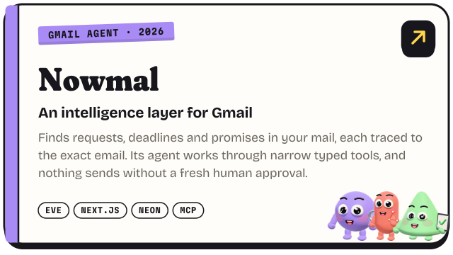</a>
<a href="https://github.com/danschewy/concierge">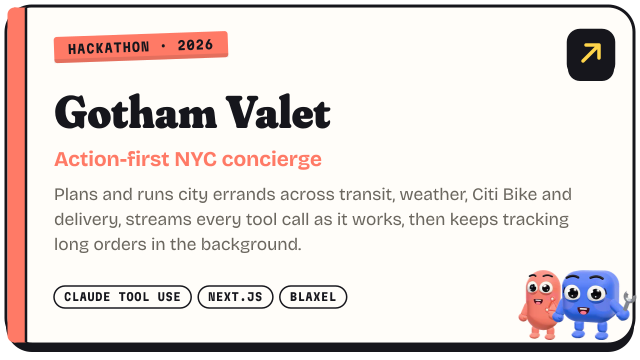</a>
<a href="https://github.com/danschewy/twelvesocial">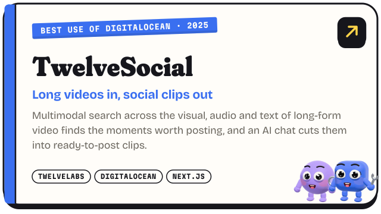</a>
<a href="https://uncompiler.com">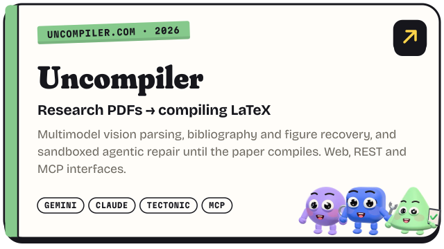</a>
<a href="https://danbrand.nyc">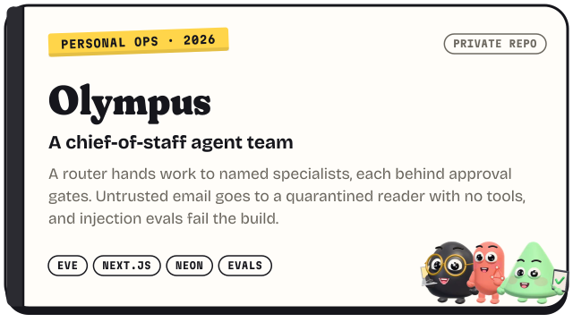</a>
<a href="https://github.com/danschewy/trading-mind">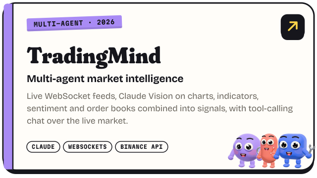</a>
<a href="https://danbrand.nyc">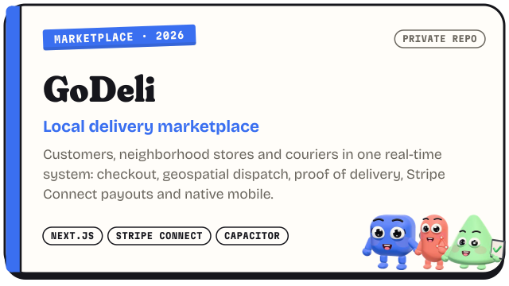</a>
<a href="https://danbrand.nyc">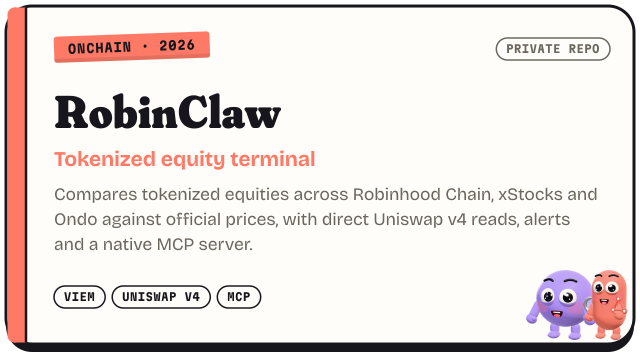</a>

  Demos: <a href="https://nowmal.vercel.app/demo">Nowmal</a> · <a href="https://concierge-puce.vercel.app">Gotham Valet</a> · <a href="https://twelvesocial.vercel.app">TwelveSocial</a> · <a href="https://uncompiler.com">Uncompiler</a> · <a href="https://trading-mind.vercel.app">TradingMind</a>

 


- 🥈 **2nd Overall** · Fractal Tech × FlowGlad, 2025
- 🥉 **3rd Place** · Lovable × Radion.build, 2025
- 🏆 **Best Use of DigitalOcean** · TwelveSocial, Hacking Agents Hackathon NYC, 2025
- 🏆 **Best Use of Comet** · Weaviate / Comet / Friendli, 2025
- 🏆 **Best Use of Weaviate** · Weaviate / Timescale, 2025
- 🥇 **1st Place** · Drexel Senior Design, Top Humanitarian Project, 2021

**Daily drivers:** Claude Code · Codex · MCP · Eve · Next.js · React · TypeScript · Postgres · pgvector · Weaviate · Stripe · GitHub Actions · Docker

 

<a href="https://danbrand.nyc"></a>
